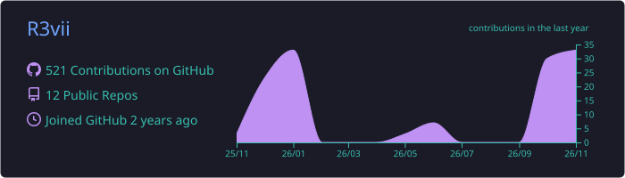
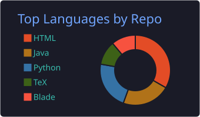
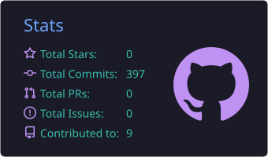

## 

  

---

### === About Me ===
Im just a guy who loves raccoons (in case it wasnt obvious🦝). In my free time, I like to tinker with:

  

---

### === GitHub Stats ===

  
  
  

---

<picture>
  <source media="(prefers-color-scheme: dark)" srcset="https://raw.githubusercontent.com/R3vii/R3vii/output/github-contribution-grid-snake-dark.svg">
  <source media="(prefers-color-scheme: light)" srcset="https://raw.githubusercontent.com/R3vii/R3vii/output/github-contribution-grid-snake.svg">
  
</picture>

